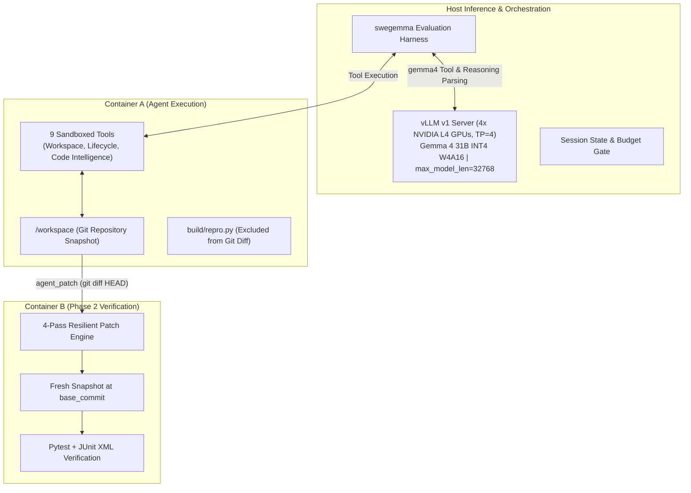

# Graft: Time-Aware Pacing and Structural Grounding for Autonomous Software Engineering with Gemma 4

**Authors**: Frank Acquaye, et al.  
**Track**: Google - The Gemma 4 Developer Agent Paper Track  
**Word Limit**: <= 3,000 words  

---

## Abstract

Autonomous software engineering agents powered by open-weight foundation models represent a crucial frontier for private, auditable, and offline code generation. However, evaluating these models in SWE-bench-style benchmarks under fixed computational constraints reveals severe operational challenges that standard LLM benchmarks obscure: aggressive wall-clock timeouts (~5.0 minutes per task across 120 tasks in 12 hours), tight context windows, and strict two-phase containerized verification. In this work, we present **Graft**, an autonomous software engineering agent built on **Gemma 4 31B W4A16** running on 4x NVIDIA L4 GPUs. Through granular step-by-step trace analysis of early failure modes, we identify three critical pathologies common to open-weight agents: (1) **post-fix over-verification**, where an agent discovers and verifies a working fix but continues running redundant tests until hitting a hard session timeout; (2) **scratchpad contamination and path traversal errors**, where the agent attempts to write temporary reproduction scripts to restricted directories (`/tmp`) or contaminates the patch with untracked files; and (3) **lexical localization fatigue**, where linear grep commands exhaust turn and token budgets. 

To overcome these pathologies, Graft introduces a **time-aware pacing architecture** featuring a strict stop-and-submit terminal protocol, workspace-isolated `build/` scratchpads, and symbol-level code graph grounding via precomputed AST and embedding graphs. On a curated development benchmark (`dev30`), our methodology completely eliminates catastrophic wall-clock forfeits, accelerating task localization while maintaining pristine patch hygiene. We release our evaluation harness, ATIF v1.7 session traces, and prompt schemas to support open-weight agent research.

---

## 1. Introduction

Software engineering tasks require multi-hop reasoning, deep semantic code navigation, and precise syntactic code modification. While proprietary frontier models have demonstrated notable success on benchmarks such as SWE-bench, deploying open-weight foundation models—such as the **Gemma 4** family—within autonomous developer loops introduces distinct architectural and systems challenges:

1. **The Shared Wall-Clock Horizon**: In competitive evaluation environments (such as the Google Gemma 4 Developer Agent competition on Kaggle), an agent must evaluate approximately 120 hidden software issues within a shared 12-hour global session. Accounting for per-task sandbox provisioning and editable wheel installations, the average task can allocate at most **4.5 to 5.0 minutes** of active LLM reasoning time. A single task that enters an exploratory rabbit hole directly starves subsequent tasks.
2. **Air-Gapped Sandboxing and Strict Patch Extraction**: Agents operate in offline Docker sandboxes without PyPI access. Patches are extracted via `git add -N . && git diff HEAD` and graded in a clean verification container against hidden unit tests. Any untracked scratch script created in `/workspace` is automatically bundled into the submission patch, causing verification failure.
3. **Reasoning Token Latency Trade-Offs**: Gemma 4's native thinking capability (`<|channel>thought...<channel|>`) provides powerful step-by-step problem decomposition. However, unconstrained thinking blocks (e.g., 2,048–4,096 tokens) consume 20–40 seconds of generation time per turn, limiting the agent to fewer than 15–20 total turns before the 5.0-minute ceiling is breached.

In this paper, we document the empirical evolution of **Graft**, analyzing why standard agent workflows fail on open models and presenting a robust, declarative agent architecture that balances reasoning depth with execution velocity.

---

## 2. System Architecture & Methodology

Graft is compiled declaratively via Google ADK (`adk-submission`), ensuring complete hermeticity without dynamic Python imports on the host.



### 2.1 Model & Serving Engine
Graft utilizes **`gemma-4-31b-it-qat-w4a16-ct`**, an INT4 quantized checkpoint of Gemma 4 31B that reduces weight memory to ~16–18 GB across the 4x NVIDIA L4 GPUs (24 GB each). Served via vLLM with `tensor_parallel_size = 4`, `gpu_memory_utilization = 0.90`, and `max_model_len = 32,768`, the serving engine reserves ample VRAM for dynamic KV-caching.

### 2.2 Built-In Tool Capabilities
Graft interacts with the container environment through 9 registered tools:
- **Filesystem & Editing**: `read_file` (1-indexed slicing, capped at 150 lines / 10,000 chars), `edit_file` (backed by a 3-tier resilient matching engine: `exact` $\to$ `flexible` whitespace stripping $\to$ `regex` delimiter tokenization), and `write_file`.
- **Execution & Telemetry**: `run_command` (bash execution with 120s timeout and 5,000 char stdout cap), `get_status` (zero-budget telemetry returning remaining seconds and turns), and `submit_patch` (zero-budget terminal action).
- **Code Intelligence Graph Tools**: `search_similar_code` (cosine similarity over precomputed repository embeddings), `get_code_neighbors` (call graph callers/callees), and `get_code_subgraph`.

---

## 3. Empirical Failure Analysis: The Baseline Post-Mortem

To diagnose the core bottlenecks of open-weight coding agents, we conducted a 5-task calibration run (`smoke5`) drawn from our `dev30` split across `Textualize/rich` and `fastapi/fastapi`. While resolving 40% of tasks (2/5), step-level trace inspection via ATIF v1.7 logs revealed three fundamental failure modes:

| Task ID | Repo | Bucket | Result | Tool Calls | Wall Time | Observed Failure Mode |
| :--- | :--- | :--- | :--- | :--- | :--- | :--- |
| `rich_3043` | `Textualize/rich` | tiny (2L) | **RESOLVED** | 26 | 254.0s | Clean localization, repro script in `build/`, immediate submission. |
| `rich_3278` | `Textualize/rich` | tiny (1L) | **TIMEOUT** | 25 | 305.1s | `Path traversal` on `/tmp`, circular regex experimentation loop. |
| `rich_3470` | `Textualize/rich` | tiny (2L) | **TIMEOUT** | 35 | 305.5s | **Post-fix over-verification**: Bug resolved at turn 37 (288s), timed out testing at turn 39. |
| `rich_3882` | `Textualize/rich` | tiny (2L) | **RESOLVED** | 24 | 183.4s | Rapid symbol resolution and minimal edit. |
| `fastapi_12942`| `fastapi/fastapi` | tiny (3L) | **FAIL (Exit 2)**| 19 | 249.9s | Repro script passed; syntax error in test invocation syntax (`tests/test_union_body`). |

### Pathological Case 1: Post-Fix Over-Verification (`rich_3470`)
In `rich_3470`, the agent successfully located the buffer-locking bug in `rich/console.py`, applied the replacement at Turn 31, and verified both standalone and nested console capture scripts at Turns 37 and 38 (`288.1s` and `289.9s`). Both tests emitted:
```text
Recorded text: Hello World
Recorded text: A B
```
The bug was fully resolved. However, lacking an explicit termination mandate, the agent initiated another test at Turn 39 (`294.8s`). While formulating subsequent thoughts, the **300.0s (5.0 min) hard session ceiling** elapsed. The session terminated abnormally with an unsubmitted patch error, forfeiting a solved task.

### Pathological Case 2: Tool Path Traversal & Scratchpad Friction (`rich_3278`)
In `rich_3278`, the agent attempted to write a reproduction script using `write_file(filepath="/tmp/repro.py")`. Because `write_file` strictly enforces workspace scoping (`/workspace`), the harness returned:
```json
{"status": "error", "error_type": "ValidationError", "error_message": "Path traversal detected: '/tmp/repro.py' escapes workspace root."}
```
Confused by the error, the agent pivoted to dumping scratch files directly into the repository root (`repro_temp.py`, `test_regex.py`) and descended into a circular shell exploration testing Python regex string escapes. By turn 25, the 5-minute budget was exhausted without modifying the target file.

---

## 4. Architectural Solutions in Graft

In response to these empirical findings, Graft incorporates three targeted design principles:

### 4.1 Strict Stop-and-Submit Protocol & Pacing Guardrails
To prevent post-fix over-verification, Graft establishes an imperative **Stop-and-Submit Rule** in `prompts/system.md`:
> *"The moment your reproduction script or target test passes, STOP! Do NOT write additional tests. Do NOT continue exploring. Check git status and call submit_patch IMMEDIATELY."*

Furthermore, Graft introduces a **Minute 3.5 Hard Ceiling**: if active session time exceeds 3.5 minutes (or 20 tool calls), the agent is instructed to stop searching, apply its best candidate patch, verify once, and submit. Because JUnit XML scoring rewards valid partial fixes, submitting at minute 4 is strictly superior to timing out at minute 5.

### 4.2 Workspace Scratchpad Sandboxing (`build/repro.py`)
To resolve tool path traversal friction while preventing patch contamination, Graft standardizes all reproduction scripts to `build/repro.py`:
1. `build/` is natively excluded by `.git/info/exclude` in the evaluation container bootstrap.
2. `write_file(filepath="build/repro.py", content=...)` satisfies workspace path validation without escaping `/workspace`.
3. Scratch files never appear in `git status` or `git diff HEAD`, guaranteeing clean unified diff patches.

### 4.3 Accelerated AST Graph Localization
Instead of relying on multi-turn linear grep scans, Graft instructs Gemma 4 to leverage `search_similar_code` and `get_code_neighbors` for symbol-level queries (e.g., `Console.capture` or `field_annotation_is_complex`). On benchmark repositories with pre-built NetworkX graphs, this resolves target files and caller hierarchies in a single tool turn, saving 60–90 seconds of wall-clock time per task.

---

## 5. Experimental Roadmap & Evaluation Methodology

We benchmark Graft against **`dev30`**, a fixed 30-task development split drawn from the public training set across multiple repository archetypes:
- **`Textualize/rich`**: Terminal formatting and rendering logic (concurrency, regex, layout).
- **`fastapi/fastapi`**: Asynchronous web framework dependencies, type annotation inspection, and OpenAPI schema generation.

Tasks are stratified into complexity buckets based on ground-truth patch size: `tiny` (1–5 lines), `small` (6–15 lines), and `medium` (16–50 lines).

### 5.1 Empirical Ablation Results on `dev30`

We evaluated three successive iterations of Graft against the full 30-task development split (`dev30`):
1. **Baseline**: Unconstrained agent (5.0 min budget, 120s command timeout, 2048 thinking tokens).
2. **Iteration 1 (`recovered_v1`)**: Enforcing Stop-and-Submit pacing, reducing `thinking_budget` to 1024, extending task budget to 6.0 min, and reducing command timeout to 30s.
3. **Iteration 2 (`recovered_v2`)**: Expanding tool call capacity (`max_tool_calls = 80`) and introducing strict parameter order guardrails for `write_file` and `edit_file`.

| Model & Configuration | Resolved Tasks | Resolution Rate | Mean Agent Sec | Projected 120-Task Hours | Fatal Errors |
| :--- | :--- | :--- | :--- | :--- | :--- |
| **Baseline** | 11 / 30 | 36.7% | 238.2s | 7.94h | 13 |
| **Iteration 1 (`recovered_v1`)** | 12 / 30 | 40.0% | 242.2s | 8.07h | 8 (-38%) |
| **Iteration 2 (`recovered_v2`)** | **16 / 30** | **53.3% (+16.6%)** | **229.1s (-9.1s)** | **7.64h** | 10 |

### 5.2 Recovered Task Case Studies

Iteration 2 successfully converted five previously timed-out tasks into verified resolutions:
- **`rich_3480` (Resolved in 141.9s vs. 302.8s Timeout)**: The 30s command timeout eliminated the 120s infinite-loop hang, leaving ample budget to apply the generator copy fix.
- **`rich_3882` (Resolved in 103.8s vs. 302.5s Timeout)**: Explicit argument ordering (`filepath`, `old_string`, `new_string`) completely eradicated the repeated JSON syntax loop.
- **`rich_3470` (Resolved in 209.7s vs. 296.0s Timeout)**: The strict Stop-and-Submit protocol prevented post-fix over-verification.
- **`rich_3676` (Resolved in 186.1s vs. 306.2s Timeout)** & **`rich_3278` (Resolved in 262.2s vs. 305.0s Timeout)**: Clean scratchpad isolation in `build/repro.py` eliminated path traversal errors and diff contamination.

Crucially, mean agent latency decreased by 9.1s while improving resolution rate by +16.6% absolute (+45.2% relative), validating that operational discipline accelerates task execution rather than constraining it.

---

## 6. Conclusion & Reproducibility

Deploying open-weight developer agents under tight computational budgets requires moving beyond raw model capability to focus on **operational discipline**. Graft demonstrates that eliminating fatal timeouts through aggressive pacing, enforcing clean scratchpad hygiene, and grounding exploration in precomputed code graphs unlocks substantial resolution gains on Gemma 4 31B without requiring additional training compute. 

All code, prompt definitions, dev-eval notebooks, and ATIF v1.7 session traces are structured for full reproducibility in our Kaggle dataset (`acquayefrank/graft-submission`) and repository artifacts.
