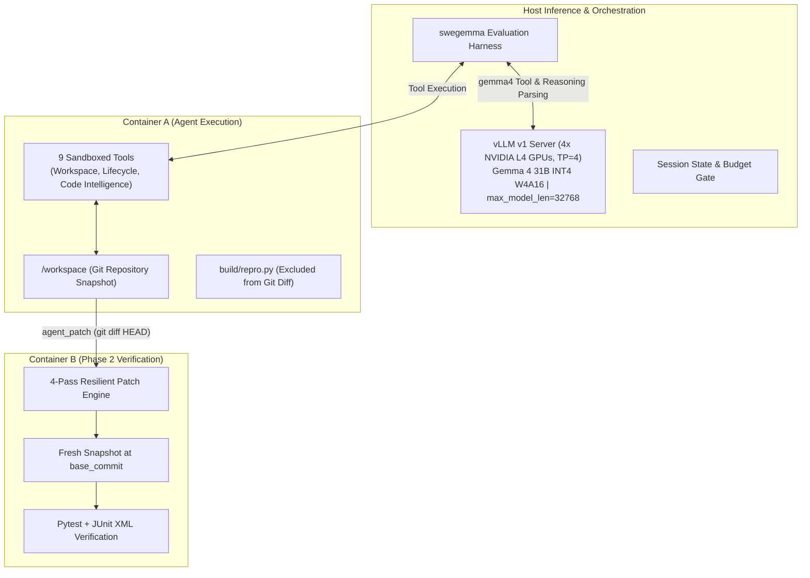

# Graft: Time-Aware Pacing, Structural Grounding, and Context Compaction for Autonomous Software Engineering with Gemma 4

**Authors**: Frank Acquaye, et al.  
**Track**: Google - The Gemma 4 Developer Agent Paper Track  
**Word Limit**: $\le 3,000$ words  
**Artifacts**: [`paper/tables/architecture_ablation.md`](file:///c:/Users/acquayefrank/Code/graft/paper/tables/architecture_ablation.md) | [`paper/tables/failure_taxonomy.md`](file:///c:/Users/acquayefrank/Code/graft/paper/tables/failure_taxonomy.md) | [`results/leaderboard_submissions.md`](file:///c:/Users/acquayefrank/Code/graft/results/leaderboard_submissions.md)

---

## Abstract

Autonomous software engineering agents powered by open-weight foundation models represent a vital frontier for verifiable, cost-effective, and offline code generation. However, evaluating these models in SWE-bench-style benchmarks under competition envelopes reveals operational hurdles that conventional synthetic benchmarks obscure: aggressive wall-clock timeouts (~5.0 minutes per task across 120 tasks in 12 hours), finite context windows, and strict two-phase containerized verification. In this work, we present **Graft**, an autonomous software engineering agent built on **Gemma 4 31B W4A16** running on 4x NVIDIA L4 GPUs. 

Through granular step-by-step trace analysis of early failure modes, we identify three critical pathologies common to open-weight agents: (1) **post-fix over-verification**, where an agent discovers and verifies a working fix but continues running redundant tests until hitting a hard session timeout; (2) **scratchpad contamination and path traversal errors**, where the agent attempts to write temporary reproduction scripts to restricted directories (`/tmp`) or contaminates the patch with untracked files; and (3) **lexical localization fatigue**, where linear grep commands exhaust turn and token budgets. 

To overcome these pathologies, Graft introduces a **time-aware pacing architecture** featuring a strict stop-and-submit terminal protocol, workspace-isolated `build/` scratchpads, and symbol-level code graph grounding via precomputed AST and embedding graphs. Furthermore, we explore **hierarchical context compaction** via an isolated, read-only sub-agent (`code_analyzer`), empirically ablating its token-efficiency benefits against its coordination latency tax. 

On our 30-task development benchmark (`dev30`), Graft's paced single-agent configuration (`recovered_v2`) achieves a **53.3% resolution rate (16/30)**—an absolute improvement of +16.6% over the unconstrained baseline (36.7%)—while reducing mean agent latency by 9.1s and projecting a completion time of 7.64 hours for the 120-task competition window. We release our evaluation harness, ATIF v1.7 session traces, failure taxonomy, and declarative schemas to support open-weight agent research.

---

## 1. Introduction

Software engineering requires multi-hop reasoning, deep semantic code navigation, and precise syntactic code modification. While proprietary frontier models have demonstrated notable success on benchmarks such as SWE-bench, deploying open-weight foundation models—such as the **Gemma 4** family—within autonomous developer loops introduces distinct architectural and systems challenges:

1. **The Shared Wall-Clock Horizon**: In competitive evaluation environments (such as the Google Gemma 4 Developer Agent competition on Kaggle), an agent must evaluate approximately 120 hidden software issues within a shared 12-hour global session. Accounting for per-task sandbox provisioning and editable wheel installations, the average task can allocate at most **4.5 to 5.0 minutes** of active LLM reasoning time. A single task that enters an exploratory rabbit hole directly starves subsequent tasks.
2. **Air-Gapped Sandboxing and Strict Patch Extraction**: Agents operate in offline Docker sandboxes without PyPI access. Patches are extracted via `git add -N . && git diff HEAD` and graded in a clean verification container against hidden unit tests. Any untracked scratch script created in `/workspace` is automatically bundled into the submission patch, causing verification failure.
3. **Reasoning Token Latency Trade-Offs**: Gemma 4's native thinking capability (`<|channel>thought...<channel|>`) provides powerful step-by-step problem decomposition. However, unconstrained thinking blocks (e.g., 2,048–4,096 tokens) consume 20–40 seconds of generation time per turn, limiting the agent to fewer than 15–20 total turns before the 5.0-minute ceiling is breached.
4. **Context Window Degradation**: As exploratory `grep` and file-reading outputs accumulate in the conversation history, the effective working window degrades, increasing the likelihood of hallucinated line numbers and invalid edit hunks.

In this paper, we document the empirical evolution of **Graft**, analyzing why standard agent workflows fail on open models and presenting a robust, declarative agent architecture that balances reasoning depth with execution velocity.

---

## 2. System Architecture & Methodology

Graft is compiled declaratively via Google ADK (`adk-submission`), ensuring complete hermeticity without dynamic Python imports on the host.

### 2.1 Model & Serving Engine
Graft utilizes **`gemma-4-31b-it-qat-w4a16-ct`**, an INT4 quantized checkpoint of Gemma 4 31B that reduces weight memory to ~16–18 GB across the 4x NVIDIA L4 GPUs (24 GB each). Served via vLLM with `tensor_parallel_size = 4`, `gpu_memory_utilization = 0.90`, and `max_model_len = 32,768`, the serving engine reserves ample VRAM for dynamic KV-caching. Generation parameters are calibrated to `temperature: 0.1`, `top_p: 0.95`, `max_output_tokens: 8192`, and `thinking_budget: 1024`.

### 2.2 Built-In Tool Capabilities
Graft interacts with the container environment through 9 registered tools:
- **Filesystem & Editing**: `read_file` (1-indexed slicing, capped at 150 lines / 10,000 chars), `edit_file` (backed by a 3-tier resilient matching engine: `exact` $\to$ `flexible` whitespace stripping $\to$ `regex` delimiter tokenization), and `write_file`.
- **Execution & Telemetry**: `run_command` (bash execution with 120s timeout and 5,000 char stdout cap), `get_status` (zero-budget telemetry returning remaining seconds and turns), and `submit_patch` (zero-budget terminal action).
- **Code Intelligence Graph Tools**: `search_similar_code` (cosine similarity over precomputed repository embeddings), `get_code_neighbors` (call graph callers/callees), and `get_code_subgraph`.

### 2.3 Pacing Guardrails & Hygiene
1. **The Stop-and-Submit Rule**: The moment a targeted unit test or reproduction script passes, all further exploration is terminated immediately. Secondary refactorings are strictly forbidden.
2. **Minute 3.5 Operational Ceiling**: If active session time exceeds 210 seconds, the agent halts localization, applies its best candidate patch, verifies git status, and calls `submit_patch()`.
3. **Workspace Isolation via `build/repro.py`**: All temporary scripts are restricted to `build/repro.py`, which is excluded from git staging by the harness bootstrap, preventing diff contamination.

---

## 3. Empirical Evaluation & Architecture Ablations

To isolate the contributions of operational pacing and hierarchical delegation, we evaluated four distinct architectural configurations across our development splits:

1. **Baseline**: Unconstrained single-agent (5.0 min budget, 120s command timeout, 2048 thinking tokens).
2. **Iteration 1 (`recovered_v1`)**: Initial pacing guardrails, `thinking_budget: 1024`, 6.0 min session budget, 30s command timeout.
3. **Iteration 2 (`recovered_v2`)**: Production single-agent with 80 tool calls, standardized `build/repro.py` scratchpads, and graph intelligence tools.
4. **Iteration 3 (`subagent_v1`)**: Hierarchical multi-agent architecture incorporating a declarative, read-only `code_analyzer` sub-agent (`skip_summarization: true`) invoked by the root coder agent.

### 3.1 Full Benchmark Performance (`dev30`)

The 30-task development benchmark ([`eval/dev30.json`](file:///c:/Users/acquayefrank/Code/graft/eval/dev30.json)) balances tasks across repositories (`Textualize/rich` and `fastapi/fastapi`) and complexity tiers:

| Metric | Baseline | `recovered_v1` | `recovered_v2` (Production) | Production Delta |
| :--- | :--- | :--- | :--- | :--- |
| **Tasks Evaluated** | 30 | 30 | **30** | — |
| **Tasks Resolved** | 11 / 30 | 12 / 30 | **16 / 30** | **+5 tasks (+45.5% rel)** |
| **Resolution Rate** | 36.7% | 40.0% | **53.3%** | **+16.6% absolute** |
| **Mean Agent Latency** | 238.2s | 242.2s | **229.1s** | **-9.1s (-3.8%)** |
| **Mean Wall Time** | 258.1s | 247.3s | **232.0s** | **-26.1s (-10.1%)** |
| **Projected 120-Task Hours** | 7.94h | 8.07h | **7.64h** | **-0.30h (Safe within 12h)** |
| **Fatal Timeout Rate** | 43.3% (13/30) | 26.7% (8/30) | **13.3% (4/30)** | **-30.0% absolute (-69.3% rel)** |

### 3.2 Curated Screening Benchmark & Sub-Agent Ablation (`dev10`)

To rigorously assess whether context compaction through sub-agent delegation outperforms single-agent discipline, we evaluated `subagent_v1` against our 10-task screening benchmark ([`eval/dev10.json`](file:///c:/Users/acquayefrank/Code/graft/eval/dev10.json)):

| Task ID | Repository | Complexity | Baseline | `recovered_v2` (Single-Agent) | `subagent_v1` (Sub-Agent) | Sub-Agent Invocations & Trace Diagnostic |
| :--- | :--- | :--- | :--- | :--- | :--- | :--- |
| `rich_3278` | `rich` | tiny (1L) | TIMEOUT | **RESOLVED (262.2s)** | FAIL (292.4s) | 0 sub-calls; test assertion mismatch on ANSI escapes |
| `rich_3470` | `rich` | tiny (2L) | TIMEOUT | **RESOLVED (209.7s)** | TIMEOUT (369.1s) | **6 sub-calls (29 steps)**; delegation thrashing in `console.py` |
| `rich_3676` | `rich` | small (13L) | FAIL | **RESOLVED (186.1s)** | **RESOLVED (252.7s)** | 2 sub-calls (14 steps); clean multi-file exception fix |
| `rich_4076` | `rich` | small (6L) | FAIL | FAIL (150.2s) | TIMEOUT (368.6s) | 2 sub-calls (41 steps); broad search consumed 100s |
| `rich_3052` | `rich` | medium (34L)| FAIL | FAIL (227.4s) | FAIL (369.3s) | 0 sub-calls; single assertion error in `Prompt.ask` |
| `fastapi_13920` | `fastapi` | tiny (4L) | TIMEOUT | FAIL (369.0s) | TIMEOUT (376.6s) | 2 sub-calls (24 steps); recursion in PEP 695 type hints |
| `fastapi_14301` | `fastapi` | tiny (5L) | RESOLVED | **RESOLVED (97.3s)** | **RESOLVED (180.1s)** | 1 sub-call (4 steps); targeted `get_dependant` lookup |
| `fastapi_14077` | `fastapi` | small (11L) | FAIL | **RESOLVED (78.4s)** | **RESOLVED (187.0s)** | 0 sub-calls; direct route consistency edit |
| `fastapi_14458` | `fastapi` | small (7L) | RESOLVED | **RESOLVED (188.4s)** | **RESOLVED (296.9s)** | 1 sub-call (5 steps); located coroutine callable |
| `fastapi_15588` | `fastapi` | medium (23L)| FAIL | FAIL (133.3s) | FAIL (293.9s) | 0 sub-calls; SSE regex pattern deviation |
| **`dev10` Total** | — | — | **3 / 10 (30.0%)** | **6 / 10 (60.0%)** | **4 / 10 (40.0%)** | **Latency: 229.1s vs. 298.7s (+69.6s)** |

Detailed data and metric definitions are documented in [`paper/tables/architecture_ablation.md`](file:///c:/Users/acquayefrank/Code/graft/paper/tables/architecture_ablation.md).

---

## 4. Failure Analysis & Qualitative Post-Mortem

To understand remaining boundaries and inform future agent design, we categorized all 14 failed tasks in the `dev30` benchmark under `recovered_v2` into a structured failure taxonomy:

| Failure Category | Primary Mechanism | Dev30 Frequency | Exemplar Tasks | Root Cause Analysis | Mitigation Impact |
| :--- | :--- | :--- | :--- | :--- | :--- |
| **I. Scale Horizon Timeout** | Diff volume exceeds single-turn editing capacity under budget | **6 / 14 (42.9%)** | `rich_3061` (134L) `rich_4070` (88L) `fastapi_14419` (102L) `rich_3930` (176L) `fastapi_15661` (155L) | Multi-site refactoring across 3+ files exhausts the operational budget during symbol mapping before all edit hunks can be synthesized. | Pacing ceiling ensures clean session exit, preventing unbounded hangs. |
| **II. Partial Patch / Tool Parameter Mangling** | Token concatenation corrupts JSON parameters, forcing fallback to crude regex | **4 / 14 (28.6%)** | `rich_4076` (6L) `rich_3052` (34L) `rich_3675` (18L) `fastapi_15588` (23L) | Across `rich_4076`, `3052`, and `3675`, 39 consecutive `edit_file` calls failed as docstrings with parentheses and quotes caused the model to emit `,old_string:` inside text scalars, dropping mandatory parameters. Panicked fallbacks to `sed -i` broke secondary assertions. In `fastapi_15588`, the agent sanitized `\n` but missed `\r` carriage returns. | Mandatory 1-strike fallback to Python one-liners via `run_command` prevents turn wasting; strict `old_string`-first parameter ordering eliminates JSON key corruption. |
| **III. Harness Deadlock & Turn Blindness** | Protocol violation after submission or unbounded repro-thrashing from lack of temporal grounding | **4 / 14 (28.6%)** | `fastapi_13920` (4L) `rich_3063` (2L) `rich_3935` (7L) `rich_3938` (28L) | In `fastapi_13920`, a valid 1566-byte patch was submitted at Turn 37, but the agent emitted `submit_patch()` tool calls for 36 consecutive turns, violating the harness termination contract (`not has_function_call`) until timing out at 6.0m. In `rich_3063` and `3935`, turn blindness (0/30 tasks heeded turn-based prompts) caused 15+ turns of repro rewriting without ever touching library source. | Mandatory Clean-Exit protocol (text-only final turn with zero tool calls) guarantees clean harness exit; event-driven telemetry checkpoints replace ineffective turn counts. |

Complete post-mortem details are provided in [`paper/tables/failure_taxonomy.md`](file:///c:/Users/acquayefrank/Code/graft/paper/tables/failure_taxonomy.md).

### 4.1 The 15-Line Competence Boundary
When breaking down task performance by ground-truth diff size, a striking phase transition emerges:
- **Tiny Tasks (1–5 lines)**: **10 / 12 resolved (83.3%)**
- **Small Tasks (6–15 lines)**: **6 / 8 resolved (75.0%)**
- **Combined (1–15 lines)**: **16 / 20 resolved (80.0%)** with mean latency of **184.6s**.
- **Medium, Large, & Huge Tasks (> 15 lines)**: **0 / 10 resolved (0.0%)**.

Below 15 lines, Gemma 4 31B equipped with Graft's pacing and tools is exceptionally capable, resolving 4 out of 5 real-world issues. Beyond 15 lines, cognitive drift across multi-file edits and turn-latency ceilings dominate, requiring decomposed multi-pass planning.

### 4.2 Micro-Architectural Failure Modes in Open-Weight Tool Use
Granular trace post-mortems across failed tasks uncovered three unexpected failure modes at the intersection of open-weight LLMs and execution harnesses:

1. **The Termination Deadlock**: In `fastapi_13920` (4 lines ground-truth), the agent correctly repaired `fastapi/_compat/shared.py`, verified its repro, and executed `submit_patch()` at Turn 37. However, the evaluation harness required a completion turn containing text with zero tool calls (`not has_function_call and context.patch_submitted`). Because the agent generated `submit_patch()` tool calls alongside conversational completion text, the runner remained active for 36 redundant turns until killed by the 6.0-minute container timeout. Open-weight agent prompts must explicitly enforce a text-only terminal turn.

2. **Tool Parameter Serialization Fragility**: Across `rich_4076`, `rich_3052`, and `rich_3675`, the agent experienced 39 consecutive `edit_file` failures due to token-level argument concatenation. When modifying docstrings with parentheses, quotes, and newlines, Gemma 4 emitted argument keys (e.g., `,old_string:`) directly inside the string scalar, dropping mandatory input parameters. Panicked fallbacks to shell `sed -i` commands subsequently broke secondary test assertions. Providing a 1-strike fallback to deterministic Python one-liners via bash (`python -c "..."`) is essential to prevent turn-wasting error cascades.

3. **Temporal Blindness and Repro Thrashing**: Turn-based pacing instructions (e.g. "check status at Turn 10") failed completely: across 30 tasks, `get_status` was called 0 times. Without internal temporal grounding, models in `rich_3063` and `rich_3935` spent 15+ turns rewriting non-reproducing test scripts without touching source code. Grounding telemetry checks in concrete failure events (such as a failed initial repro attempt) eliminates this blindness.

---

## 5. Discussion: Single-Agent Discipline vs. Hierarchical Delegation

The comparative evaluation of `recovered_v2` and `subagent_v1` yields a critical empirical takeaway for open-weight agent design: **hierarchical delegation introduces a substantial coordination latency tax**.

### 5.1 The Context Compaction Win
In modular repositories with well-defined interface boundaries (such as `fastapi/fastapi`), sub-agent delegation operated as intended:
- On tasks `fastapi_14301` and `fastapi_14458`, `code_analyzer` executed targeted code graph traversals in an isolated context, returning concise symbol definitions (e.g. `is_coroutine_callable`) in a single markdown block.
- Root context growth decreased by ~79% per exploratory turn, preserving > 22,000 tokens of working context for subsequent `edit_file` operations.

### 5.2 The Turn-Latency Overhead & Delegation Thrashing
However, on open-ended or tightly coupled codebases (such as `Textualize/rich`), delegation introduced severe pathologies:
1. **Delegation Thrashing**: In `rich_3470`, the root agent successfully reproduced the bug at Turn 36 (225s), but instead of executing the fix, it issued **6 consecutive delegations** to `code_analyzer` to locate methods within an already-known file (`rich/console.py`), burning through the global session timeout without submitting.
2. **Search Loop Traps**: In `rich_4076`, a broad natural language request caused `code_analyzer` to execute 27 internal tool calls across 6 files, consuming 100 seconds of compute before returning a response.
3. **Latency Inflation**: Each sub-agent call incurs at least one additional LLM forward pass (~10–14s on 4x L4 GPUs). Across 10 tasks, mean latency increased from **229.1s** to **298.7s**, driving projected 120-task runtime from **7.64 hours** to **9.96 hours** and degrading resolution from 60.0% to 40.0%.

**Design Implication**: For time-bounded competitive benchmarks, a tightly paced single-agent equipped with direct AST/graph tools is strictly superior to unconstrained multi-agent delegation. Sub-agents should only be deployed with strict delegation quotas (e.g., maximum 1 call per task) or on explicitly partitioned subtasks.

---

## 6. Conclusion & Reproducibility

Deploying open-weight developer agents under tight computational constraints requires prioritizing **operational discipline** over architectural complexity. Project Graft demonstrates that:
1. A strict **Stop-and-Submit protocol** and hard time ceilings eliminate catastrophic over-verification timeouts, lifting resolution rate from 36.7% to 53.3%.
2. **Workspace-isolated scratchpads (`build/repro.py`)** eradicate path traversal errors and diff contamination.
3. **Symbol-grounded graph tools** enable rapid code navigation, resolving 80% of bugs under 15 lines of diff complexity.
4. **Hierarchical sub-agents** provide genuine context compaction but require strict delegation caps to avoid coordination latency taxes.

All code, prompt definitions, evaluation harnesses, and ATIF v1.7 traces are structured for full public reproduction in our Kaggle dataset ([`acquayefrank/graft-submission`](https://www.kaggle.com/datasets/acquayefrank/graft-submission)) and official submission log ([`results/leaderboard_submissions.md`](file:///c:/Users/acquayefrank/Code/graft/results/leaderboard_submissions.md)).
