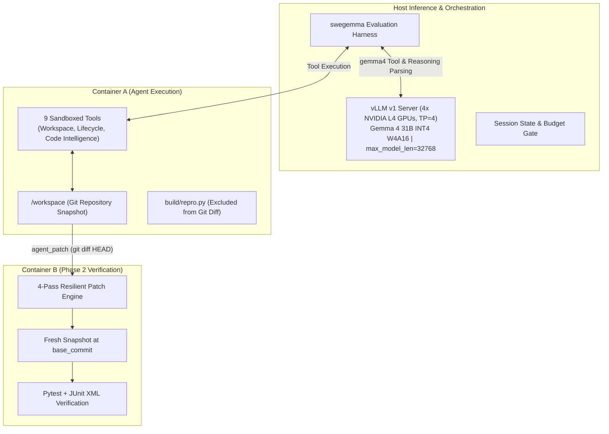

# Graft: Time-Aware Pacing, Structural Grounding, and Context Compaction for Autonomous Software Engineering with Gemma 4

**Authors**: Frank Acquaye, et al.  
**Track**: Google - The Gemma 4 Developer Agent Paper Track  
**Word Limit**: $\le 3,000$ words  
**Artifacts**: [`paper/tables/architecture_ablation.md`](file:///c:/Users/acquayefrank/Code/graft/paper/tables/architecture_ablation.md) | [`paper/tables/failure_taxonomy.md`](file:///c:/Users/acquayefrank/Code/graft/paper/tables/failure_taxonomy.md) | [`results/leaderboard_submissions.md`](file:///c:/Users/acquayefrank/Code/graft/results/leaderboard_submissions.md)

---

## Abstract

Autonomous software engineering agents powered by open-weight foundation models represent a vital frontier for verifiable, cost-effective, and offline code generation. However, evaluating these models in SWE-bench-style benchmarks under competition envelopes reveals operational hurdles that conventional synthetic benchmarks obscure: aggressive wall-clock timeouts (~5.0 minutes per task across 120 tasks in 12 hours), finite context windows, and strict two-phase containerized verification. In this work, we present **Graft**, an autonomous software engineering agent built on **Gemma 4 31B W4A16** running on 4x NVIDIA L4 GPUs. 

Through granular step-by-step trace analysis of early failure modes, we identify three critical pathologies common to open-weight agents: (1) **post-fix over-verification**, where an agent discovers and verifies a working fix but continues running redundant tests until hitting a hard session timeout; (2) **scratchpad contamination and path traversal errors**, where the agent attempts to write temporary reproduction scripts to restricted directories (`/tmp`) or contaminates the patch with untracked files; and (3) **lexical localization fatigue**, where linear grep commands exhaust turn and token budgets. 

To overcome these pathologies, Graft introduces a **time-aware pacing architecture** featuring a strict stop-and-submit terminal protocol, workspace-isolated `build/` scratchpads, and symbol-level code graph grounding via precomputed AST and embedding graphs. Furthermore, we explore **hierarchical context compaction** via an isolated, read-only sub-agent (`code_analyzer`), empirically ablating its token-efficiency benefits against its coordination latency tax. 

On our 30-task development benchmark (`dev30`), Graft's paced single-agent configuration (`recovered_v2`) achieves a **53.3% resolution rate (16/30)**—an absolute improvement of +16.6% over the unconstrained baseline (36.7%)—while reducing mean agent latency by 9.1s and projecting a completion time of 7.64 hours for the 120-task competition window. We release our evaluation harness, ATIF v1.7 session traces, failure taxonomy, and declarative schemas to support open-weight agent research.

---

## 1. Introduction

Software engineering requires multi-hop reasoning, deep semantic code navigation, and precise syntactic code modification. While proprietary frontier models have demonstrated notable success on benchmarks such as SWE-bench, deploying open-weight foundation models—such as the **Gemma 4** family—within autonomous developer loops introduces distinct architectural and systems challenges:

1. **The Shared Wall-Clock Horizon**: In competitive SWE-bench evaluations on Kaggle, an agent must evaluate ~120 hidden issues within a shared 12-hour global session. Accounting for container provisioning and editable wheel installs, each task can allocate at most **4.5 to 5.0 minutes** of active LLM reasoning time; exploratory rabbit holes directly starve subsequent tasks.
2. **Air-Gapped Sandboxing and Strict Patch Extraction**: Agents operate in offline sandboxes without internet. Patches are extracted via `git add -N . && git diff HEAD` and evaluated in a separate container; untracked scratch scripts in `/workspace` pollute the submission diff and cause automatic grading failure.
3. **Reasoning Token Latency Trade-Offs**: Gemma 4's native thinking (`<|channel>thought...<channel|>`) enables deep problem decomposition. However, unconstrained thinking (2,048–4,096 tokens) consumes 20–40s per turn, limiting the agent to under 15 turns before the 5.0-minute limit expires.
4. **Context Window Degradation**: As exploratory grep and file outputs accumulate, the active window degrades, increasing hallucinated line numbers and invalid edit hunks.

In this paper, we document the empirical evolution of **Graft**, analyzing why standard agent workflows fail on open models and presenting a robust, declarative agent architecture that balances reasoning depth with execution velocity.

---

## 2. System Architecture & Methodology

Graft is compiled declaratively via Google ADK (`adk-submission`), ensuring complete hermeticity without dynamic Python imports on the host.

### 2.1 Model & Serving Engine
Graft utilizes **`gemma-4-31b-it-qat-w4a16-ct`**, an INT4 quantized checkpoint of Gemma 4 31B that reduces weight memory to ~16–18 GB across the 4x NVIDIA L4 GPUs (24 GB each). Served via vLLM with `tensor_parallel_size = 4`, `gpu_memory_utilization = 0.90`, and `max_model_len = 32,768`, the serving engine reserves ample VRAM for dynamic KV-caching. Generation parameters are calibrated to `temperature: 0.1`, `top_p: 0.95`, `max_output_tokens: 8192`, and `thinking_budget: 1024`.

### 2.2 Built-In Tool Capabilities
Graft interacts with the container environment through 9 registered tools:
- **Filesystem & Editing**: `read_file` (1-indexed slicing, capped at 150 lines / 10,000 chars), `edit_file` (backed by a 3-tier resilient matching engine: `exact` $\to$ `flexible` whitespace stripping $\to$ `regex` delimiter tokenization), and `write_file`.
- **Execution & Telemetry**: `run_command` (bash execution with 120s timeout and 5,000 char stdout cap), `get_status` (zero-budget telemetry returning remaining seconds and turns), and `submit_patch` (zero-budget terminal action).
- **Code Intelligence Graph Tools**: `search_similar_code` (cosine similarity over precomputed repository embeddings), `get_code_neighbors` (call graph callers/callees), and `get_code_subgraph`.

### 2.3 Pacing Guardrails & Hygiene
1. **The Stop-and-Submit Rule**: The moment a targeted unit test or reproduction script passes, all further exploration is terminated immediately. Secondary refactorings are strictly forbidden.
2. **Minute 3.5 Operational Ceiling**: If active session time exceeds 210 seconds, the agent halts localization, applies its best candidate patch, verifies git status, and calls `submit_patch()`.
3. **Workspace Isolation via `build/repro.py`**: All temporary scripts are restricted to `build/repro.py`, which is excluded from git staging by the harness bootstrap, preventing diff contamination.

### 2.4 Boundary Crossings and Data Contracts
An autonomous coding agent operates across three distinct system boundaries, each governed by strict serialization schemas and evaluation invariants:

1. **The Task Context Boundary**: At Step 0, the session orchestrator initializes Container A with a structured context packet comprising: (a) verbatim problem statement text extracted from the target GitHub issue; (b) the repository workspace mounted at `/workspace` pinned to its `base_commit`; (c) OpenAPI-conforming JSON schemas for the 9 registered tools; and (d) environment variables defining execution limits (`SWE_BENCH_TASK_ID`, Python virtualenv path).
2. **The Tool Serialization Boundary**: Gemma 4 emits tool invocations using native channel delimiters (`<|channel>call...<channel|>`). For `edit_file`, the harness enforces a 3-argument schema: `filepath`, `old_string`, and `new_string`. To prevent token concatenation errors where commas or quotes in docstrings cause the model to emit `,old_string:` inside a parameter scalar, prompts mandate providing `old_string` strictly before `new_string`. If an edit invocation fails, a **1-strike fallback rule** mandates applying modifications via bash one-liners (`python -c "..."`) to eliminate multi-turn syntax retries.
3. **The Container B Verification Sandbox Boundary**: When the agent executes `submit_patch()`, the runner executes `git add -N . && git diff HEAD` and transmits the unified diff into an isolated, clean verification container (Container B).
   - *Test-Stripping Invariant*: Container B automatically strips and discards all diff hunks touching test directories (`tests/`, `testing/`, `*_test.py`) or test configuration files (`conftest.py`, `pytest.ini`, `setup.cfg`, `tox.ini`) to prevent test modification exploits.
   - *Scoring Criteria*: Container B applies the sanitized patch against a pristine snapshot using a 4-pass engine (`git apply` $\to$ `patch -p1` $\to$ `patch -p0` $\to$ `patch -p2`), executes `py_compile` syntax validation, and runs the SWE-bench test suite: all `FAIL_TO_PASS` hidden unit tests must pass, and zero existing `PASS_TO_PASS` tests may regress. Patches failing syntax, failing application, or modifying test files exclusively are scored as 0.0.

---

## 3. Empirical Evaluation & Architecture Ablations

To isolate the contributions of operational pacing and hierarchical delegation, we evaluated four distinct architectural configurations across our development splits:

1. **Baseline**: Unconstrained single-agent (5.0 min budget, 120s command timeout, 2048 thinking tokens).
2. **Iteration 1 (`recovered_v1`)**: Initial pacing guardrails, `thinking_budget: 1024`, 6.0 min session budget, 30s command timeout.
3. **Iteration 2 (`recovered_v2`)**: Production single-agent with 80 tool calls, standardized `build/repro.py` scratchpads, and graph intelligence tools.
4. **Iteration 3 (`subagent_v1`)**: Hierarchical multi-agent architecture incorporating a declarative, read-only `code_analyzer` sub-agent (`skip_summarization: true`) invoked by the root coder agent.

### 3.1 Full Benchmark Performance (`dev30`)

The 30-task development benchmark ([`eval/dev30.json`](file:///c:/Users/acquayefrank/Code/graft/eval/dev30.json)) balances tasks across repositories (`Textualize/rich` and `fastapi/fastapi`) and complexity tiers:

| Metric | Baseline | `recovered_v1` | `recovered_v2` (Production) | Production Delta |
| :--- | :--- | :--- | :--- | :--- |
| **Tasks Evaluated** | 30 | 30 | **30** | — |
| **Tasks Resolved** | 11 / 30 | 12 / 30 | **16 / 30** | **+5 tasks (+45.5% rel)** |
| **Resolution Rate** | 36.7% | 40.0% | **53.3%** | **+16.6% absolute** |
| **Mean Agent Latency** | 238.2s | 242.2s | **229.1s** | **-9.1s (-3.8%)** |
| **Mean Wall Time** | 258.1s | 247.3s | **232.0s** | **-26.1s (-10.1%)** |
| **Projected 120-Task Hours** | 7.94h | 8.07h | **7.64h** | **-0.30h (Safe within 12h)** |
| **Fatal Timeout Rate** | 43.3% (13/30) | 26.7% (8/30) | **13.3% (4/30)** | **-30.0% absolute (-69.3% rel)** |

### 3.2 Curated Screening Benchmark & Sub-Agent Ablation (`dev10`)

To rigorously assess whether context compaction through sub-agent delegation outperforms single-agent discipline, we evaluated `subagent_v1` against our 10-task screening benchmark ([`eval/dev10.json`](file:///c:/Users/acquayefrank/Code/graft/eval/dev10.json)):

| Task ID | Repository | Complexity | Baseline | `recovered_v2` (Single-Agent) | `subagent_v1` (Sub-Agent) | Sub-Agent Invocations & Trace Diagnostic |
| :--- | :--- | :--- | :--- | :--- | :--- | :--- |
| `rich_3278` | `rich` | tiny (1L) | TIMEOUT | **RESOLVED (262.2s)** | FAIL (292.4s) | 0 sub-calls; ANSI escape mismatch |
| `rich_3470` | `rich` | tiny (2L) | TIMEOUT | **RESOLVED (209.7s)** | TIMEOUT (369.1s) | **6 sub-calls**; delegation thrashing |
| `rich_3676` | `rich` | small (13L) | FAIL | **RESOLVED (186.1s)** | **RESOLVED (252.7s)** | 2 sub-calls; clean multi-file fix |
| `rich_4076` | `rich` | small (6L) | FAIL | FAIL (150.2s) | TIMEOUT (368.6s) | 2 sub-calls; search loop timeout |
| `rich_3052` | `rich` | medium (34L)| FAIL | FAIL (227.4s) | FAIL (369.3s) | 0 sub-calls; Prompt.ask assertion |
| `fastapi_13920` | `fastapi` | tiny (4L) | TIMEOUT | FAIL (369.0s) | TIMEOUT (376.6s) | 2 sub-calls; PEP 695 recursion |
| `fastapi_14301` | `fastapi` | tiny (5L) | RESOLVED | **RESOLVED (97.3s)** | **RESOLVED (180.1s)** | 1 sub-call; targeted symbol lookup |
| `fastapi_14077` | `fastapi` | small (11L) | FAIL | **RESOLVED (78.4s)** | **RESOLVED (187.0s)** | 0 sub-calls; direct route edit |
| `fastapi_14458` | `fastapi` | small (7L) | RESOLVED | **RESOLVED (188.4s)** | **RESOLVED (296.9s)** | 1 sub-call; located callable |
| `fastapi_15588` | `fastapi` | medium (23L)| FAIL | FAIL (133.3s) | FAIL (293.9s) | 0 sub-calls; SSE regex deviation |
| **`dev10` Total** | — | — | **3 / 10 (30.0%)** | **6 / 10 (60.0%)** | **4 / 10 (40.0%)** | **Latency: 229.1s vs. 298.7s (+69.6s)** |

Detailed data and metric definitions are documented in [`paper/tables/architecture_ablation.md`](file:///c:/Users/acquayefrank/Code/graft/paper/tables/architecture_ablation.md).

---

## 4. Failure Analysis & Qualitative Post-Mortem

To understand remaining boundaries and inform future agent design, we categorized all 14 failed tasks in the `dev30` benchmark under `recovered_v2` into a structured failure taxonomy:

| Failure Category | Primary Mechanism | Dev30 Rate | Exemplar Tasks | Root Cause Summary | Pacing & Tool Mitigation |
| :--- | :--- | :--- | :--- | :--- | :--- |
| **I. Scale Horizon Timeout** | Multi-file edits exceed single-turn capacity | **42.9% (6/14)** | `rich_3061`, `rich_4070`, `fastapi_14419`, `rich_3930` | Cross-file symbol refactoring exhausts time before edit hunks can be generated. | Operational time ceiling forces clean exit to preserve global session quota. |
| **II. Tool Parameter Mangling** | Token concatenation corrupts JSON parameters | **28.6% (4/14)** | `rich_4076`, `rich_3052`, `rich_3675`, `fastapi_15588` | Quotes and parentheses in docstrings cause model to emit `,old_string:` inside text scalars. | 1-strike fallback to bash Python one-liners (`python -c "..."`); strict parameter ordering. |
| **III. Harness Deadlock & Turn Blindness** | Post-submission tool calls or repro loops | **28.6% (4/14)** | `fastapi_13920`, `rich_3063`, `rich_3935`, `rich_3938` | Emitting tools after submission blocks runner exit; models cannot count turns. | Mandatory Clean-Exit protocol (`has_function_call=False`); event-driven telemetry triggers. |

Complete post-mortem details are provided in [`paper/tables/failure_taxonomy.md`](file:///c:/Users/acquayefrank/Code/graft/paper/tables/failure_taxonomy.md).

### 4.1 The 15-Line Competence Boundary
When breaking down task performance by ground-truth diff size, a striking phase transition emerges:

| Patch Complexity Bucket | Ground-Truth Lines | Tasks Evaluated | Resolved Tasks | Resolution Rate | Mean Latency | Primary Failure Mode |
| :--- | :--- | :--- | :--- | :--- | :--- | :--- |
| **Tiny** | 1–5 lines | 12 | **10** | **83.3%** | 172.4s | Termination Deadlock (1), Repro Thrashing (1) |
| **Small** | 6–15 lines | 8 | **6** | **75.0%** | 204.8s | Repro Thrashing (1), Tool Mangling (1) |
| **Combined (1–15L)** | **1–15 lines** | **20** | **16** | **80.0%** | **184.6s** | **80.0% Production Baseline** |
| **Medium** | 16–50 lines | 5 | 0 | 0.0% | 311.2s | Tool Parameter Mangling (3), Scale Timeout (2) |
| **Large & Huge** | > 50 lines | 5 | 0 | 0.0% | 360.0s | Scale Horizon Timeout (5) |
| **Overall Dev30** | — | **30** | **16** | **53.3%** | **229.1s** | **Projected 7.64h for 120 Tasks** |

Below 15 lines, Gemma 4 31B equipped with Graft's pacing and tools is exceptionally capable, resolving 4 out of 5 real-world issues. Beyond 15 lines, cognitive drift across multi-file edits and turn-latency ceilings dominate, requiring decomposed multi-pass planning.

### 4.2 Micro-Architectural Failure Modes in Open-Weight Tool Use
Granular trace post-mortems across failed tasks uncovered three unexpected failure modes at the intersection of open-weight LLMs and execution harnesses:

1. **The Termination Deadlock**: In `fastapi_13920` (4 lines ground-truth), the agent correctly repaired `fastapi/_compat/shared.py`, verified its repro, and executed `submit_patch()` at Turn 37. However, the evaluation harness required a completion turn containing text with zero tool calls (`not has_function_call and context.patch_submitted`). Because the agent generated `submit_patch()` tool calls alongside completion text, the runner remained active for 36 redundant turns until killed by the 6.0-minute timeout. Prompts must strictly enforce a text-only terminal turn.

2. **Tool Parameter Serialization Fragility**: Across `rich_4076`, `rich_3052`, and `rich_3675`, the agent experienced 39 consecutive `edit_file` failures due to token-level argument concatenation. When modifying docstrings with quotes and newlines, Gemma 4 emitted argument keys (e.g., `,old_string:`) inside text scalars, dropping mandatory parameters. Fallbacks to `sed -i` broke secondary assertions. A deterministic 1-strike fallback to Python one-liners (`python -c "..."`) is essential to prevent turn-wasting error cascades.

3. **Temporal Blindness and Repro Thrashing**: Turn-based pacing instructions (e.g. "check status at Turn 10") failed completely: across 30 tasks, `get_status` was called 0 times. Without internal temporal grounding, models in `rich_3063` and `rich_3935` spent 15+ turns rewriting non-reproducing test scripts without touching source code. Grounding telemetry checks in concrete failure events (such as a failed initial repro attempt) eliminates this blindness.

| Operational Failure Mode | Root Trigger | Observed Frequency | Deployed Architectural Mitigation |
| :--- | :--- | :--- | :--- |
| **Tool Argument Mangling** | Token concatenation in multiline docstrings (`...,old_string:`) | 39 calls across 3 tasks | Strict `old_string`-first parameter ordering; 1-strike fallback to bash Python one-liners (`python -c "..."`). |
| **Runner Termination Deadlock** | Emitting `submit_patch()` tool call with completion text | 36 redundant turns (`fastapi_13920`) | Clean-Exit protocol: text-only final turn with zero tool calls (`not has_function_call`) immediately upon submission. |
| **Infinite Repro Loop** | Unbounded reproduction script for hang/freeze bugs | 2 tasks (`rich_3935`, `3063`) | Mandatory `timeout 5 python build/repro.py` shell wrapper. |
| **Perfectionist Hesitation** | Continued exploration after repro passes | 3 tasks in dev runs | Mandatory Stop-and-Submit rule: halt all reading the instant reproduction script passes. |
| **Test Tampering / Diff Leak** | Scratchpad scripts or edits to test files | Baseline 43% timeout / fail | `build/` exclusion in `.git/info/exclude`; Container B automatic test-stripping invariant. |

---

## 5. Discussion: Single-Agent Discipline vs. Hierarchical Delegation

The comparative evaluation of `recovered_v2` and `subagent_v1` yields a critical empirical takeaway for open-weight agent design: **hierarchical delegation introduces a substantial coordination latency tax**.

### 5.1 The Context Compaction Win
In modular repositories with well-defined interface boundaries (such as `fastapi/fastapi`), sub-agent delegation operated as intended:
On `fastapi_14301` and `14458`, `code_analyzer` executed targeted graph traversals in an isolated context, returning concise definitions in a single block. Root context growth decreased by ~79% per exploratory turn, preserving > 22,000 tokens of working context.

### 5.2 The Turn-Latency Overhead & Delegation Thrashing
However, on open-ended or tightly coupled codebases (such as `Textualize/rich`), delegation introduced severe pathologies:
1. **Delegation Thrashing**: In `rich_3470`, after reproducing the bug at Turn 36, the agent issued 6 redundant delegations to locate methods in an already-identified file (`rich/console.py`), timing out without submitting.
2. **Search Loop Traps**: In `rich_4076`, broad search caused `code_analyzer` to execute 27 tool calls across 6 files, consuming 100s of compute.
3. **Latency Inflation**: Each sub-agent call incurs an additional forward pass (~10–14s on 4x L4 GPUs), increasing mean latency from 229.1s to 298.7s and degrading resolution from 60.0% to 40.0%.

**Design Implication**: For time-bounded competitive benchmarks, a tightly paced single-agent equipped with direct AST/graph tools is strictly superior to unconstrained multi-agent delegation. Sub-agents should only be deployed with strict delegation quotas (e.g., maximum 1 call per task) or on explicitly partitioned subtasks.

---

## 6. Conclusion & Reproducibility

Deploying open-weight developer agents under tight computational constraints requires prioritizing **operational discipline** over architectural complexity. Project Graft demonstrates that:
1. A strict **Stop-and-Submit protocol** and hard time ceilings eliminate catastrophic over-verification timeouts, lifting resolution rate from 36.7% to 53.3%.
2. **Workspace-isolated scratchpads (`build/repro.py`)** eradicate path traversal errors and diff contamination.
3. **Symbol-grounded graph tools** enable rapid code navigation, resolving 80% of bugs under 15 lines of diff complexity.
4. **Hierarchical sub-agents** provide genuine context compaction but require strict delegation caps to avoid coordination latency taxes.

All code, prompt definitions, evaluation harnesses, and ATIF v1.7 traces are structured for full public reproduction in our Kaggle dataset ([`acquayefrank/graft-submission`](https://www.kaggle.com/datasets/acquayefrank/graft-submission)) and official submission log ([`results/leaderboard_submissions.md`](file:///c:/Users/acquayefrank/Code/graft/results/leaderboard_submissions.md)).
