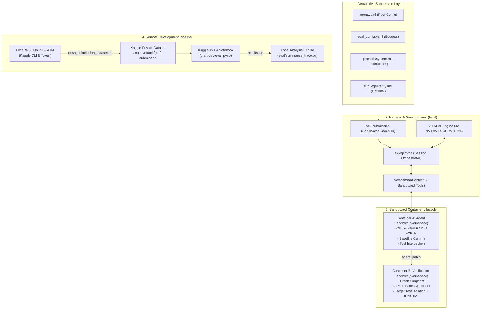

# Technical Stack & System Architecture

## 1. System Architecture Overview

The competition runtime stack consists of four interdependent layers:

---

## 2. Model & Serving Infrastructure

- **Base Model Variant**: `gemma-4-31b-it-qat-w4a16-ct`
  - Quantization: W4A16 (INT4 weights, FP16 activations).
  - VRAM Footprint: `~16–18 GB` across 4 GPUs (`~4.5 GB / GPU`), leaving substantial head-room for KV-cache and LoRA buffers.
- **Inference Engine**: `vLLM`
  - Accelerator: **4 × NVIDIA L4 GPUs (96 GB Total VRAM)**.
  - Tensor Parallelism: `tensor_parallel_size = 4`.
  - Memory Allocation: `gpu_memory_utilization = 0.90`.
  - Context Window: `max_model_len = 32,768` tokens.
  - Tool & Reasoning Parsing: `tool_call_parser = "gemma4"`, `reasoning_parser = "gemma4"`.
  - Thought Delimiters: `<|channel>thought...<channel|>`.
- **Generation Parameters (`GenerateContentConfig`)**:
  - `temperature`: `0.2` (low temperature for deterministic code editing).
  - `top_p`: `0.95`.
  - `max_output_tokens`: `8192` (strictly within the 32,768 context limit).
  - `thinking_config`:
    - `include_thoughts: true`.
    - `thinking_budget: 2048` (bounds reasoning to avoid eating tool call tokens or triggering output truncation).

---

## 3. Declarative Agent Framework (`adk-submission`)

- **Security & Sandboxing**: Competitors submit declarative YAML configuration only (`agent.yaml`). Arbitrary Python imports (`importlib`) and external code execution on the host are disabled.
- **Sandboxed `!include` Directives**: Prompts (`.md`, `.txt`) and sub-configs (`.yaml`) are resolved relative to the submission root with strict path traversal blocking.
- **Structural Limits**: Total uncompressed submission package must not exceed **`3 GiB`** (`3,221,225,472` bytes).

---

## 4. Built-In Tools & Code Intelligence (`swegemma.tools`)

The agent has access to 9 sandboxed tools registered in `ToolRegistry`:

| Tool | Category | Budget Counted | Key Behavior & Constraints |
| :--- | :--- | :--- | :--- |
| `run_command` | Execution | **Yes** | Shell command in `/bin/bash -c` in `/workspace`. Max output `5,000` chars; 120s timeout. |
| `submit_patch` | Lifecycle | **No** (Free) | Stages changes with `git add -N .`, extracts diff vs `baseline`, marks session finished. |
| `get_status` | Telemetry | **No** (Free) | Returns remaining seconds, tool calls, and turns. |
| `read_file` | Filesystem | **Yes** | 1-indexed slicing. Capped at `150` lines and `10,000` chars per call. |
| `edit_file` | Filesystem | **Yes** | 3-tier resilient matching (`exact` $\to$ `flexible` $\to$ `regex`). Requires unique match. |
| `write_file` | Filesystem | **Yes** | Writes under `/workspace/<filepath>`. Path traversal (`/tmp`, `..`) is blocked. |
| `search_similar_code` | Graph AI | **Yes** | Queries AST/dependency embeddings via cosine similarity for symbol paths. |
| `get_code_neighbors` | Graph AI | **Yes** | Returns callers and callees in the precomputed NetworkX repository graph. |
| `get_code_subgraph` | Graph AI | **Yes** | Extracts induced subgraph connecting multiple symbols. |

---

## 5. Verification Lifecycle & Metric

- **Phase 1 (Container A)**: Agent operates in `/workspace` with pre-installed wheels and editable repository install. Generates `agent_patch`.
- **Phase 2 (Container B)**: Clean verification container.
  - Strips edits to protected test/config files (`tests/`, `conftest.py`, `pytest.ini`, `setup.cfg`).
  - Applies `agent_patch` using 4 fallback passes (`git apply` variants and GNU `patch`).
  - Resets target test files to `eval_baseline` and applies `task.test_patch`.
  - Runs hermetic `pytest` with JUnit XML validation (`passed_tests > 0`, `failures == 0`, `errors == 0`).
- **Scoring Metric**:
  $$\text{Resolution Rate} = \frac{\text{Resolved Tasks}}{\text{Total Tasks}} \in [0.0, 1.0]$$

---

## 6. Development & Deployment Tooling

- **Local Development Environment**: Windows 11 with WSL2 (Ubuntu-24.04).
  - Kaggle API token stored at `/home/acquayefrank/.kaggle/kaggle.json`.
  - Kaggle CLI installed at `~/.local/bin/kaggle`.
- **Remote Dataset Push**:
  - Script: [`push_submission_dataset.sh`](file:///c:/Users/acquayefrank/Code/graft/push_submission_dataset.sh)
  - Packages `submission/` into private Kaggle dataset `acquayefrank/graft-submission`.
- **Remote Evaluation Notebook**:
  - Generator: [`notebook/build_notebook.py`](file:///c:/Users/acquayefrank/Code/graft/notebook/build_notebook.py)
  - Notebook: [`notebook/graft-dev-eval.ipynb`](file:///c:/Users/acquayefrank/Code/graft/notebook/graft-dev-eval.ipynb)
  - Configured with `NvidiaL4` x4 GPU acceleration, offline mode, and competition datasets attached.
- **Trace Analysis**:
  - Compact CLI summarizer: [`eval/summarize_trace.py`](file:///c:/Users/acquayefrank/Code/graft/eval/summarize_trace.py)
  - Parses ATIF v1.7 session traces to inspect step durations, prompt/completion token usage, and tool error patterns.

---

## 7. Research Paper Track Pipeline (`gemma-4-developer-agent-paper`)

- **Paper Format & Constraints**:
  - Venue: *Google - The Gemma 4 Developer Agent Paper Track* on Kaggle.
  - Length: Maximum **3,000 words** writeup.
  - Core Tracks: *Tuning & Optimization*, *Code Comprehension & Graph Reasoning*, or *Tasks & Benchmarks*.
- **Experiment Provenance & Data Logging**:
  - Structured Run Artifacts: Every run saved in `results/<run_name>/` with `dev_summary.json`, `dev_rows.jsonl`, and full ATIF traces.
  - Evaluation Splits: Fixed calibration and dev sets (`eval/dev30.json`) spanning multiple repositories (`Textualize/rich`, `fastapi/fastapi`, etc.) and difficulty tiers.
- **Paper Artifacts Directory (`paper/`)**:
  - `paper/draft.md`: Working manuscript (<= 3,000 words).
  - `paper/tables/`: Markdown/LaTeX tables comparing resolution rate, mean tool calls, wall-clock timing, and failure breakdowns across ablations.
  - `paper/figures/`: Trajectory progression charts, token budget consumption, and tool frequency distributions.
